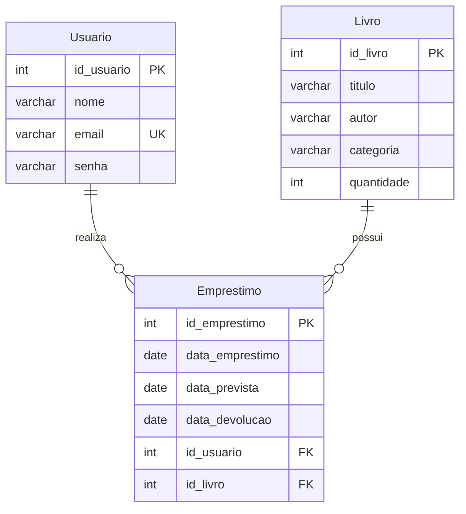

# Diagrama Entidade Relacionamento

- Um usuário pode ter zero ou vários empréstimos. Cada empréstimo tem um único usuário.
- Um livro pode aparecer em zero ou vários empréstimos. Cada empréstimo corresponde a um exemplar daquele título.
- `data_prevista` guarda o prazo; `data_devolucao` guarda a data real e fica nula enquanto o empréstimo está ativo.
- `quantidade` representa os exemplares disponíveis, não o estoque total.
- `email` é único. `senha` guarda hash PBKDF2-SHA256.
- Todos os campos são obrigatórios, exceto a devolução real. As chaves estrangeiras impedem apagar registros com histórico vinculado.
